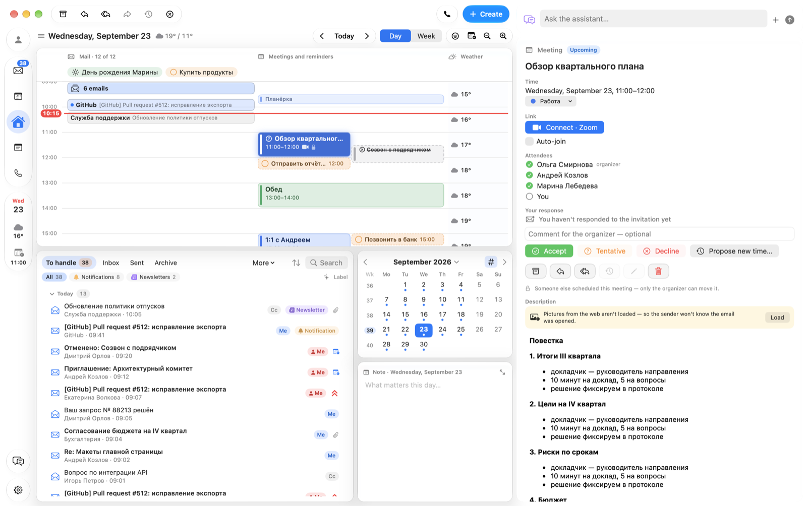
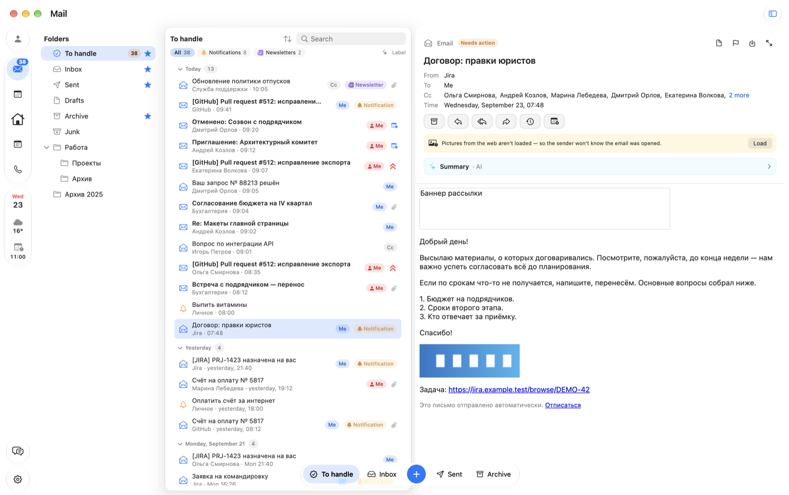
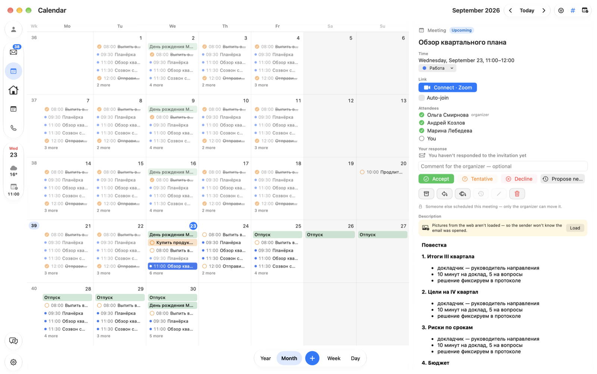
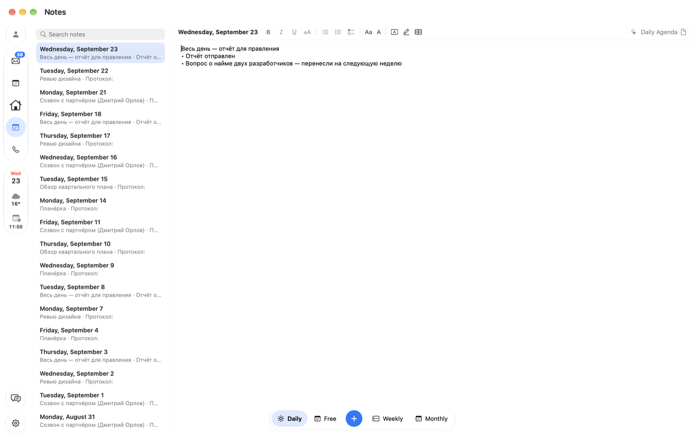
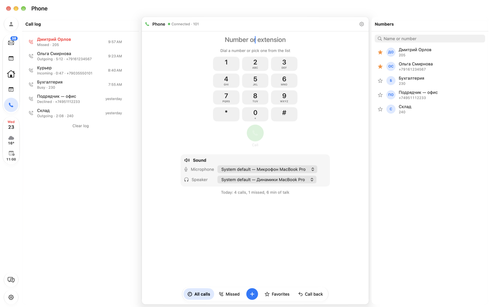

# Trudaybook

[Русский](README.md) · **English** · [简体中文](README.zh.md)

A macOS workspace: mail, calendar, notes and phone in one window. At its
heart is the day timeline: emails sit where they arrived, meetings where
they start, and everything still to sort piles up in one list until you
clear it.



**Everything stays on your Mac.** Mail comes straight from your mail
servers, passwords live in the macOS Keychain, AI runs on this same Mac,
and the app has no server of its own. What goes where —
[in a separate section](#what-leaves-your-mac).

---

## Contents

- [Home](#home) · [Mail](#mail) · [Calendar](#calendar) · [Notes](#notes) ·
  [Phone](#phone)
- [Assistant on this Mac](#assistant-on-this-mac) · [More](#more) ·
  [Keyboard shortcuts](#keyboard-shortcuts)
- [What leaves your Mac](#what-leaves-your-mac)
- [Install](#install) · [Requirements](#requirements) ·
  [Limitations](#limitations) · [Development](#development)

---

## Home

On the left is the section bar: Home, Mail, Calendar, Notes and Phone
(⌃⌘1–⌃⌘5). Below it is “Now”: the date, the weather, the next meeting
with a join button and missed calls; at the bottom — connection status (mail
and phone: “online”, “error” or “away” under the icon), the assistant and
settings.

Home has everything together. At the top is the day timeline: emails,
meetings and reminders by the hour. Drag any item onto **Archive**,
**Reply**, **Snooze** — or straight onto the timeline, to a new time. Below
are **To sort** for all days (Inbox Zero), the month and the day note. On the
right — the selected email or meeting in full, and with nothing selected,
a summary of the day: meetings ahead, mail to sort, reminders and the week
ahead.

---

## Mail



- iCloud, Gmail, Yandex, Mail.ru and any IMAP/SMTP server; corporate
  Exchange directly over EWS. Several mailboxes at once.
- Folders as a tree; four favorites as buttons at the bottom (by default
  To sort, Inbox, Sent, Archive).
- Search by subject and people, and on the server — by message text.
- Replies with formatting, attachments and a signature; drafts save themselves.
  Attachments are large tiles above the text; paste a screenshot with ⌘V
  right into the message.
- Any email — from the archive, another folder or already answered — can be
  moved back to To sort.
- “Out of office” auto-reply (Exchange): on or scheduled, separate text for
  colleagues and external senders; block your calendar for the same period.
- Priorities, swipes on a row, several emails at once, undo for archive and
  delete (⌘Z).

---

## Calendar



- Year, month, week and day; week numbers; which calendars to show and their
  colors — in the panel on the right. Week and day open showing 8 hours
  (changeable in Settings); weather by the hour in the day view and by the
  day in the week and month.
- macOS calendars (iCloud, Google, Exchange via Internet Accounts) and
  Exchange directly; macOS reminders on the timeline.
- A new meeting — ＋, or drag ＋ onto the day and hour you want. An editor
  with recurrence, attendees and their availability.
- Respond to an invitation right in the meeting: accept, tentative, decline,
  propose another time. Forward someone else's meeting to a colleague (⇧⌘F).
- An email dragged onto the meetings column becomes a reminder at that time.
- Join an online meeting with one button (Zoom, Teams, Telemost); ⌃⌥⌘J —
  from any app.

---

## Notes



- Daily, weekly and monthly notes, and free ones — titled by their first line.
- Formatting, lists, checkboxes, tables; a white sheet in dark mode.
- A day agenda and week or month summaries — by a model on this Mac.

---

## Phone



Calls through your company's PBX (SIP) right in Trudaybook — turn it on in
Settings → Phone. The call log, the dialer, saved and favorite numbers; the
microphone and speaker are shown under the dialer and can be changed even
mid-call. An incoming call shows a small window above all others. With TLS
the call is encrypted.

---

## Assistant on this Mac

Through [Ollama](https://ollama.com) — free, and Trudaybook offers to install
it (Settings → AI). Emails and notes go nowhere.

- **Chat** knows your meetings, emails, reminders and notes; tiles with ready
  requests (“My day”, “Awaiting reply”, “Summarize email”), questions by voice.
  A reminder, meeting or email is only **offered as a card** — you create
  and send it. ⌥⌘A — in any section.
- **Email summary**, labels “Important”, “Conversation”, “Notifications”,
  “Newsletters”.
- **Reply template** and **editing a selection**: fix mistakes, shorten,
  change the tone.

---

## More

- **Menu bar** — the month, today's meetings and “Join”.
- **Widgets** “Today” and “To sort” on the desktop.
- **Notifications** for new emails, with a reply right from the notification.
- **Look** — Liquid Glass on macOS 26, light and dark, backgrounds and the
  “Sky” theme that follows the time of day and the weather. Russian, English
  and Chinese.
- **Tutorial** on first launch, on sample data; repeat it from the profile
  menu or Help.
- **Together with [Trunook](https://github.com/TruDevLab/Trunook)** (optional) —
  emails and calls as banners in the MacBook notch, a shared day note, weather.

---

## Keyboard shortcuts

| Keys | What it does |
|---|---|
| ⌃⌘1 … ⌃⌘5 | Home, Mail, Calendar, Notes, Phone |
| ⌘N / ⇧⌘N / ⌥⌘N | New email / meeting / reminder |
| ⌘E / ⌘R / ⇧⌘F | Archive / reply / forward |
| ⌘S | Snooze or reschedule |
| ⌘Z / ⇧⌘Z | Undo / redo |
| ⌘F | Search |
| ⌘T / ⌘[ / ⌘] | Today / previous / next day |
| ⌥⌘A / ⌥⌘P | Assistant / phone |
| ⌃⌥⌘J | Join a meeting (from any app) |
| ⌘/ | All keyboard shortcuts |

---

## What leaves your Mac

- **Your mail servers** — only the ones you add: IMAP and SMTP (ports 993,
  465/587) or Exchange EWS (HTTPS).
- **Update check** — once a day, a request to `api.github.com` for the latest
  version, with the app's name and version in the header; a new version is
  downloaded from GitHub. Turn it off in Settings → Updates. The app connects
  nowhere else on its own: no analytics, no server of its own.
- **Remote images in emails** don't load until you click “Load” above the email —
  otherwise the sender would learn you opened the email. JavaScript in emails
  is always off.
- **Passwords** — in the macOS Keychain, never written to the log. The mail
  cache on disk is encrypted with a key kept in the Keychain.
- **Weather** comes from Trunook, if installed. Without it — only if you turn it
  on in Settings → Calendars → Weather: then the forecast is requested from
  Open-Meteo with coordinates rounded to about 10 km, or by city name.
- **AI** — only an Ollama model on this Mac (`127.0.0.1`); Ollama cloud models
  are never offered or used. The only downloads are Ollama itself (ollama.com)
  and models — when you press the button.
- **A response to an invitation** — to Exchange as a command to your own
  server; for a macOS calendar — as an email to the organizer from your mailbox.
- The **SIP phone** connects only to the PBX you entered; audio goes directly
  to the other party or through the PBX. Without TLS, numbers and the call travel
  unencrypted — choose TLS for calls over the internet. The password is in
  Keychain; numbers and the call log stay on this Mac.
- Trudaybook talks to Trunook only through files in `~/Library/Application Support`
  on the same Mac; Trunook sees an incoming call through Accessibility, by the
  call window.

---

## Install

> **The app is signed with a self-made certificate:** the project has no paid
> Apple developer account. On someone else's Mac, Gatekeeper won't let it
> through by default. The reliable way is to build from source — a build
> signed with your own certificate raises no questions. If you install from
> the disk image, remove the quarantine afterwards with the command below.

**From source**

```bash
git clone https://github.com/TruDevLab/Trudaybook.git
cd Trudaybook
make cert      # your own signing certificate, once
make install   # build and put into Applications
```

**From the disk image** — download `Trudaybook-<version>.dmg` from the release
page, drag Trudaybook to Applications and remove the quarantine:

```bash
sudo xattr -r -c /Applications/Trudaybook.app
```

The image carries the same instructions in “Как установить.txt”. To check
the signature: `codesign --verify --deep --strict /Applications/Trudaybook.app`.

**Updates** arrive by themselves: once a day Trudaybook asks GitHub, downloads
a new version in the background and checks its signature — only a build
signed with the same certificate is installed. An “Update to …” button
appears in the window: click it and the app restarts as the new version,
with calendar and password access still granted. A build you signed with
your own certificate can't update this way — use `git pull` and `make install`.

With no mailbox connected, Trudaybook opens with sample emails and meetings,
so you can see how it works. Add mail in Settings → Mail.

---

## Requirements

- macOS 15 or later; Liquid Glass on macOS 26.
- The disk image is built for Apple silicon Macs. On an Intel Mac, build from
  source — the build targets your processor.
- To build: Command Line Tools with Swift 6 (`xcode-select --install`).
  Xcode isn't needed.
- For iCloud, Gmail, Yandex and Mail.ru — an app password, not your main
  account password.

## Limitations

- Not notarized — see the note above.
- Gmail and Microsoft 365 with OAuth sign-in aren't supported: only an app
  password (Gmail) or your own Exchange server with EWS.
- Someone else's meeting can't be moved — only the organizer can.
- A response to a meeting from a macOS calendar (iCloud, Google) goes to
  the organizer by email from your mailbox: EventKit can't respond itself,
  and only the server updates the status in your calendar. A directly
  connected Exchange calendar responds with its own command.

## Development

Architecture, build, tests and translation — see [DEVELOPMENT.md](DEVELOPMENT.md)
(in Russian).

Found a bug? [Open an issue](../../issues/new/choose) and attach
`~/Library/Logs/Trudaybook.log` with the addresses removed.

License — [MIT](LICENSE).
