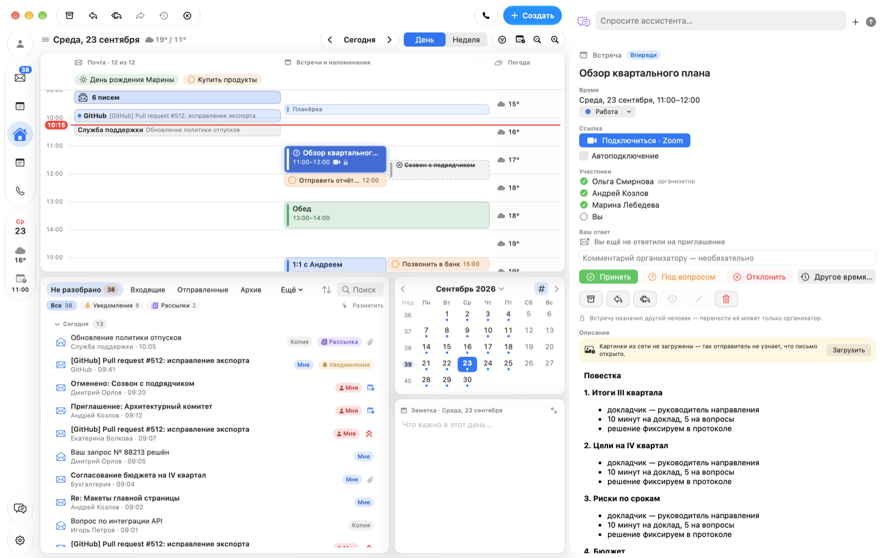
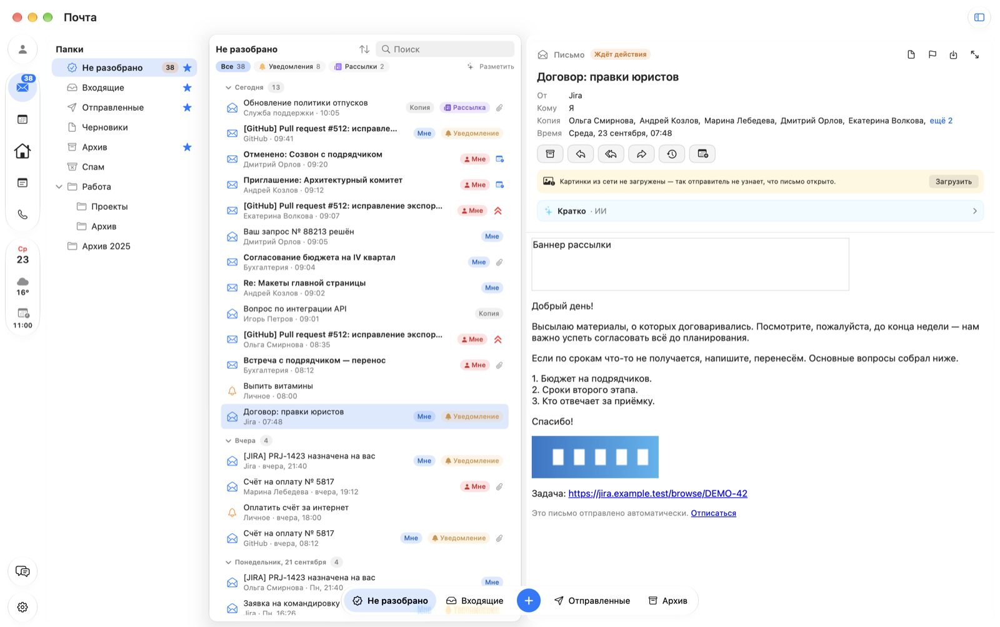
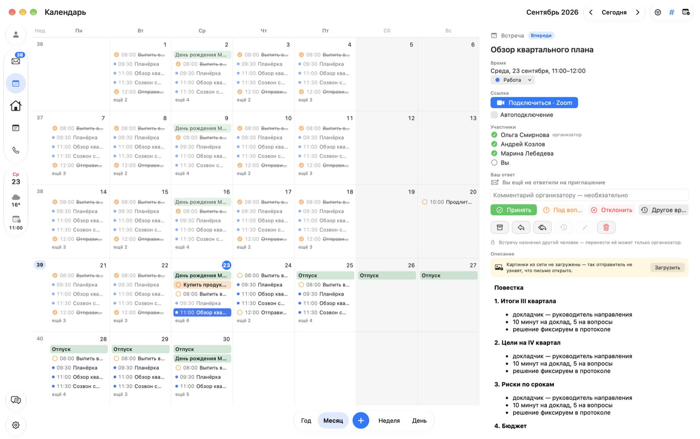
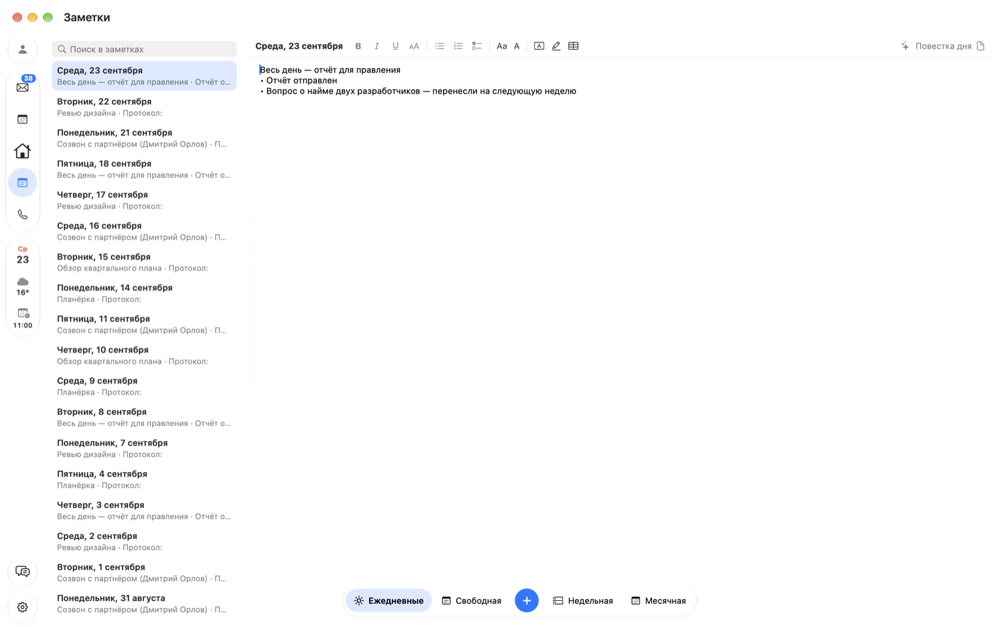
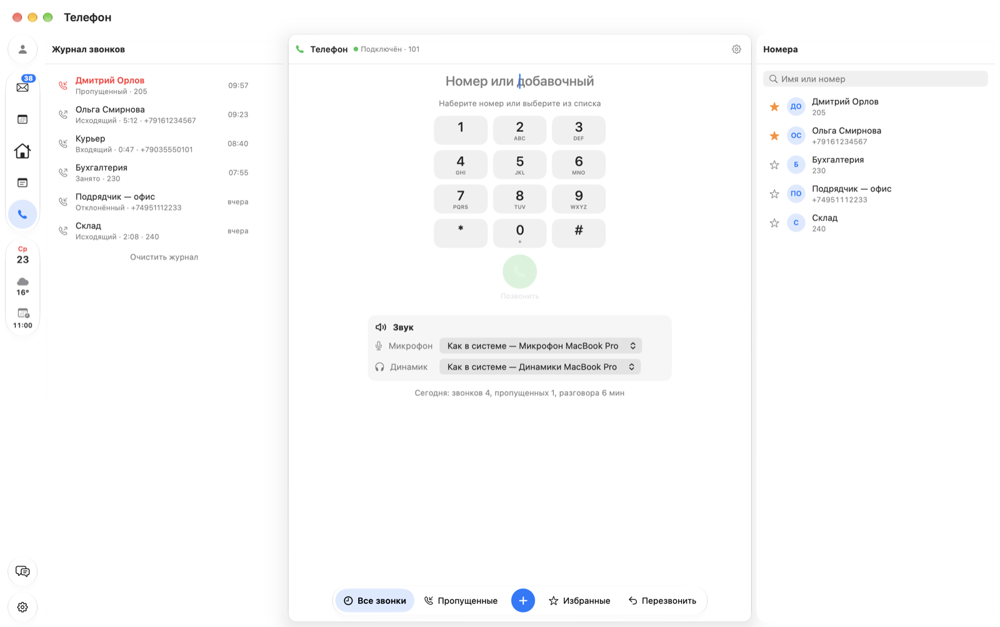

# Trudaybook

**Русский** · [English](README.en.md) · [简体中文](README.zh.md)

Рабочее место для macOS: почта, календарь, заметки и телефон в одном окне.
Главное — шкала дня: письма стоят там, когда пришли, встречи — там, когда
начнутся, а всё неразобранное копится в одном списке, пока вы его не
разберёте.



**Всё хранится на вашем Mac.** Письма приходят прямо с ваших почтовых
серверов, пароли лежат в Связке ключей macOS, ИИ работает на этом же Mac,
а своего сервера у приложения нет. Что и куда уходит —
[отдельным разделом](#что-уходит-наружу).

---

## Оглавление

- [Домашняя](#домашняя) · [Почта](#почта) · [Календарь](#календарь) ·
  [Заметки](#заметки) · [Телефон](#телефон)
- [Ассистент на этом Mac](#ассистент-на-этом-mac) · [Ещё](#ещё) ·
  [Сочетания клавиш](#сочетания-клавиш)
- [Что уходит наружу](#что-уходит-наружу)
- [Установка](#установка) · [Требования](#требования) ·
  [Ограничения](#ограничения) · [Разработка](#разработка)

---

## Домашняя

Слева — панель разделов: домашняя, почта, календарь, заметки и телефон
(⌃⌘1–⌃⌘5). Под ней — «Сейчас»: дата, погода и ближайшая встреча с кнопкой
подключения; внизу — ассистент и настройки.

На домашней всё вместе. Сверху шкала дня: письма, встречи и напоминания по
часам. Любой элемент перетаскивается на **«В архив»**, **«Ответить»**,
**«Отложить»** — или прямо на шкалу, на новое время. Внизу — **«Не разобрано»**
за все дни (принцип Inbox Zero), месяц и заметка дня. Справа — выбранное
письмо или встреча целиком, а пока ничего не выбрано — сводка дня: встречи
впереди, неразобранная почта, напоминания и неделя вперёд.

---

## Почта



- iCloud, Gmail, Яндекс, Mail.ru и любой сервер IMAP/SMTP; корпоративный
  Exchange напрямую через EWS. Несколько ящиков сразу.
- Папки деревом; четыре избранные — кнопками внизу (по умолчанию «Не
  разобрано», Входящие, Отправленные, Архив).
- Поиск по теме и людям, на сервере — и по тексту писем.
- Ответ с оформлением, вложениями и подписью; черновики сохраняются сами.
- Приоритеты, свайпы по строке, несколько писем сразу, отмена архива
  и удаления (⌘Z).

---

## Календарь



- Год, месяц, неделя и день; номера недель; какие календари показывать
  и их цвет — в панели справа.
- Календари macOS (iCloud, Google, Exchange через «Учётные записи
  интернета») и Exchange напрямую; напоминания macOS на шкале.
- Новая встреча — «＋» или перетаскиванием «＋» на нужный день и час.
  Редактор с повтором, участниками и их занятостью.
- Ответ на приглашение прямо во встрече: принять, под вопросом, отклонить,
  предложить другое время.
- Подключение к онлайн-встрече одной кнопкой (Zoom, Teams, Телемост);
  ⌃⌥⌘J — из любой программы.

---

## Заметки



- Ежедневные, недельные и месячные заметки и свободные — с названием
  из первой строки.
- Оформление, списки, дела с галочками, таблицы; белый лист в тёмной теме.
- Повестка дня и итоги недели или месяца — моделью на этом Mac.

---

## Телефон



Звонки через АТС вашей компании (SIP) прямо в Trudaybook — включается
в Настройках → Телефон. Журнал звонков, набор, сохранённые и избранные
номера; микрофон и динамик видны под набором и меняются и посреди
разговора. Входящий — окошком поверх всех окон. С TLS разговор шифруется.

---

## Ассистент на этом Mac

Через [Ollama](https://ollama.com) — бесплатно, Trudaybook сам предложит её
установить (Настройки → ИИ). Письма и заметки никуда не уходят.

- **Чат** знает ваши встречи, письма, напоминания и заметки; плитки готовых
  просьб («Мой день», «Ждут ответа», «Пересказать письмо»), вопрос голосом.
  Напоминание, встречу или письмо он только **предлагает карточкой** —
  создаёте и отправляете вы. ⌥⌘A — в любом разделе.
- **Пересказ письма**, метки «Важное», «Переписка», «Уведомления»,
  «Рассылки».
- **Шаблон ответа** и **правка выделенного**: исправить ошибки, сократить,
  сменить тон.

---

## Ещё

- **Строка меню** — месяц, встречи дня и «Подключиться».
- **Виджеты** «Сегодня» и «Не разобрано» на рабочем столе.
- **Уведомления** о новых письмах с ответом прямо из уведомления.
- **Оформление** — Liquid Glass на macOS 26, светлая и тёмная тема, фоны
  и тема «Небо» по времени суток и погоде. Русский, английский и китайский.
- **Обучение** при первом запуске, на тестовых данных; повторить — меню
  профиля или «Справка».
- **Вместе с [Trunook](https://github.com/TruDevLab/Trunook)** (по желанию) —
  письма и звонки плашками в вырезе MacBook, общая заметка дня, погода.

---

## Сочетания клавиш

| Клавиши | Что делает |
|---|---|
| ⌃⌘1 … ⌃⌘5 | Домашняя, почта, календарь, заметки, телефон |
| ⌘N / ⇧⌘N / ⌥⌘N | Новое письмо / встреча / напоминание |
| ⌘E / ⌘R / ⇧⌘F | В архив / ответить / переслать |
| ⌘S | Отложить или перенести |
| ⌘Z / ⇧⌘Z | Отменить / повторить |
| ⌘F | Поиск |
| ⌘T / ⌘[ / ⌘] | Сегодня / предыдущий / следующий день |
| ⌥⌘A / ⌥⌘P | Ассистент / телефон |
| ⌃⌥⌘J | Подключиться к встрече (из любой программы) |
| ⌘/ | Все сочетания клавиш |

---

## Что уходит наружу

- **К вашим почтовым серверам** — только к тем, что вы подключили: IMAP
  и SMTP (порты 993, 465/587) или Exchange EWS (HTTPS).
- **Проверка обновлений** — раз в сутки запрос к `api.github.com` о последней
  версии, с именем и номером версии приложения в заголовке; новая версия
  скачивается с GitHub. Выключается в Настройках → «Обновления». Больше
  приложение само никуда не соединяется: ни аналитики, ни своего сервера.
- **Картинки из интернета в письмах** не загружаются, пока вы не нажмёте
  «Загрузить» над письмом: иначе отправитель узнал бы, что письмо открыто.
  JavaScript в письмах выключен всегда.
- **Пароли** — в Связке ключей macOS, в журнал не пишутся. Кэш писем на
  диске зашифрован ключом из Связки ключей.
- **Погоду** присылает Trunook, если он стоит. Без него — только если включить
  в Настройках → Календари → «Погода»: тогда прогноз запрашивается у Open-Meteo
  с координатами, округлёнными примерно до 10 км, или по названию города.
- **ИИ** — только модель Ollama на этом Mac (`127.0.0.1`); облачные модели
  Ollama не предлагаются и не используются. Наружу ходит только скачивание
  самой Ollama (ollama.com) и моделей — по вашей кнопке.
- **Ответ на приглашение** — в Exchange командой вашему же серверу, для
  календаря macOS — письмом организатору из вашего ящика.
- **Телефон SIP** соединяется только с указанной вами АТС; звук идёт напрямую
  собеседнику или через АТС. Без TLS номера и разговор передаются открыто — для
  звонков через интернет выберите TLS. Пароль — в Связке ключей, номера
  и журнал звонков — только на этом Mac.
- Связь с Trunook — только файлами в `~/Library/Application Support`
  на этом же Mac; входящий звонок Trunook видит по окошку звонка через
  Универсальный доступ.

---

## Установка

> **Приложение подписано самодельным сертификатом:** платной учётной записи
> разработчика Apple у проекта нет. На чужом Mac Gatekeeper по умолчанию его
> не пропустит. Надёжный путь — собрать из исходников: сборка своим
> сертификатом вопросов не вызывает. Если ставите из образа, после
> копирования снимите карантин командой ниже.

**Из исходников**

```bash
git clone https://github.com/TruDevLab/Trudaybook.git
cd Trudaybook
make cert      # свой сертификат для подписи, один раз
make install   # собрать и положить в «Программы»
```

**Из образа** — скачайте `Trudaybook-<версия>.dmg` со страницы выпуска,
перетащите Trudaybook в «Программы» и снимите карантин:

```bash
sudo xattr -r -c /Applications/Trudaybook.app
```

Внутри образа то же самое написано в файле «Как установить.txt». Проверить
подпись: `codesign --verify --deep --strict /Applications/Trudaybook.app`.

**Обновления** приходят сами: раз в сутки Trudaybook спрашивает GitHub,
скачивает новую версию фоном и проверяет её подпись — ставится только
подписанное тем же сертификатом. В окне появляется кнопка «Обновить до …»:
нажали — приложение перезапустится новой версией, доступы к календарю
и паролям сохранятся. Собранное из исходников своим сертификатом так
не обновить — обновляйтесь `git pull` и `make install`.

Без подключённого ящика Trudaybook открывается с тестовыми письмами
и встречами — чтобы было видно, как всё устроено. Почта подключается
в Настройках → «Почта».

---

## Требования

- macOS 15 или новее; стекло Liquid Glass — на macOS 26.
- Образ собран для Mac на Apple silicon. На Mac с Intel соберите из исходников —
  сборка получится под ваш процессор.
- Для сборки — Command Line Tools со Swift 6 (`xcode-select --install`).
  Xcode не нужен.
- Для iCloud, Gmail, Яндекса и Mail.ru — пароль приложения, а не основной
  пароль учётной записи.

## Ограничения

- Нотаризации нет — см. блок выше.
- Gmail и Microsoft 365 со входом через OAuth не поддерживаются: только
  пароль приложения (Gmail) или свой сервер Exchange с EWS.
- Чужую встречу перенести нельзя — только организатор.
- Ответ на встречу из календаря macOS (iCloud, Google) уходит организатору
  письмом из вашего ящика: EventKit сам отвечать не умеет, и в вашем
  календаре статус обновит только сервер. Exchange, подключённый напрямую,
  отвечает своей командой.

## Разработка

Устройство, сборка, тесты и перевод — в [DEVELOPMENT.md](DEVELOPMENT.md).

Нашли ошибку — [заведите issue](../../issues/new/choose) и приложите
журнал `~/Library/Logs/Trudaybook.log`, убрав из него адреса.

Лицензия — [MIT](LICENSE).
