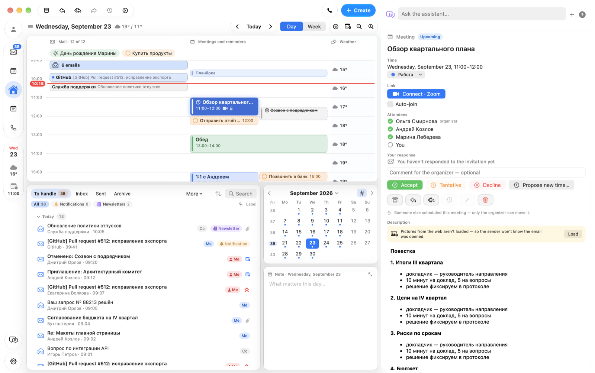
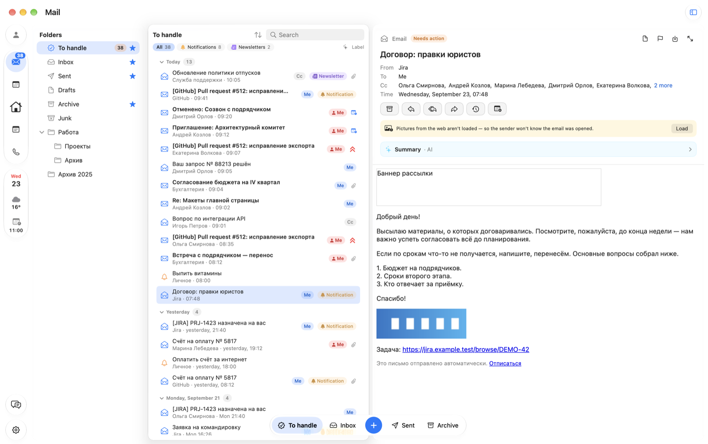
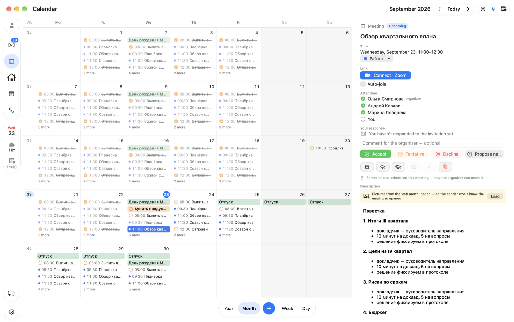
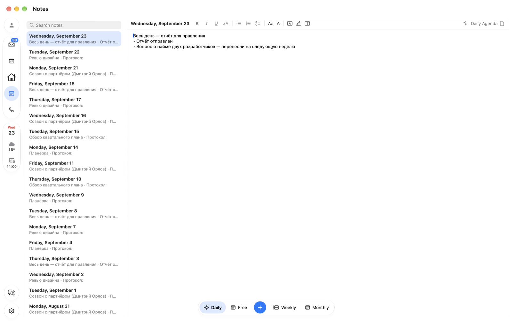
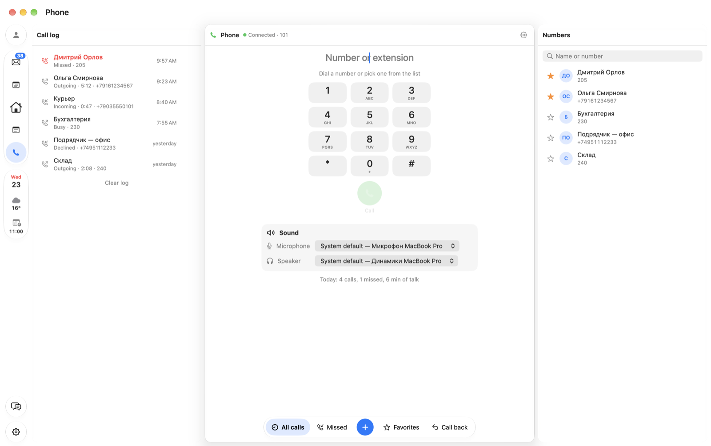

# Trudaybook

[Русский](README.md) · [English](README.en.md) · **简体中文**

macOS 上的工作台：邮件、日历、笔记和电话都在一个窗口里。核心是一天的时间轴：邮件放在收到的时间，
会议放在开始的时间，所有待处理的事项都汇集在一个列表里，直到你处理完。



**一切都保存在你的 Mac 上。** 邮件直接来自你的邮件服务器，密码保存在 macOS 钥匙串中，
AI 也在这台 Mac 上运行，应用没有自己的服务器。哪些数据会发往哪里——见[单独的章节](#哪些数据会离开你的-mac)。

---

## 目录

- [主页](#主页) · [邮件](#邮件) · [日历](#日历) · [笔记](#笔记) · [电话](#电话)
- [本机助手](#本机助手) · [更多](#更多) · [键盘快捷键](#键盘快捷键)
- [哪些数据会离开你的 Mac](#哪些数据会离开你的-mac)
- [安装](#安装) · [系统要求](#系统要求) · [限制](#限制) · [开发](#开发)

---

## 主页

左侧是分区栏：主页、邮件、日历、笔记和电话（⌃⌘1–⌃⌘5）。下方是“现在”：日期、天气、下一个会议
（带加入按钮）和未接来电；最底部是连接状态（邮件和电话：图标下方显示“在线”“错误”或“自动回复”）、助手和设置。

主页把一切放在一起。顶部是一天的时间轴：邮件、会议和提醒按小时排列。任何项目都可以拖到**归档**、
**回复**、**稍后处理**上——或直接拖到时间轴上的新时间。下方是所有日期的**待处理**（Inbox Zero）、
月历和当日笔记。右侧显示所选邮件或会议的完整内容；未选中任何内容时，显示当天摘要：
接下来的会议、待处理邮件、提醒和未来一周。

---

## 邮件



- iCloud、Gmail、Yandex、Mail.ru 以及任何 IMAP/SMTP 服务器；通过 EWS 直接连接企业 Exchange。
  可同时使用多个邮箱。
- 文件夹以树形显示；四个收藏文件夹是底部的按钮（默认为待处理、收件箱、已发送、归档）。
- 按主题和联系人搜索，在服务器上还可搜索邮件正文。
- 带格式、附件和签名的回复；草稿自动保存。附件以大图块显示在正文上方；用 ⌘V 可直接把截图粘贴到邮件中。
- 任何邮件——来自归档、其他文件夹或已回复的——都可以移回待处理。
- “外出”自动回复（Exchange）：开启或按计划，同事和外部发件人可用不同文本；可在同一时段锁定日历。
- 优先级、行上轻扫、一次处理多封邮件，归档和删除可撤销（⌘Z）。

---

## 日历



- 年、月、周、日视图；周数；右侧面板中选择显示哪些日历及其颜色。周和日视图默认显示 8 小时（可在设置中更改）；
  日视图按小时显示天气，周和月视图按天显示。
- macOS 日历（iCloud、Google、通过“互联网账户”的 Exchange）和直接连接的 Exchange；
  macOS 提醒事项显示在时间轴上。
- 新建会议——点 ＋，或把 ＋ 拖到想要的日期和时间。编辑器支持重复、参与者及其忙闲。
- 直接在会议中回复邀请：接受、暂定、拒绝、建议其他时间。可以把他人组织的会议转发给同事（⇧⌘F）。
- 拖到会议列上的邮件会成为该时间的提醒。
- 一键加入在线会议（Zoom、Teams、Telemost）；⌃⌥⌘J——在任何应用中。

---

## 笔记



- 每日、每周、每月笔记，以及自由笔记——标题取自第一行。
- 格式、列表、待办勾选、表格；深色模式下也可使用白纸。
- 当日议程以及每周或每月总结——由这台 Mac 上的模型生成。

---

## 电话



直接在 Trudaybook 中通过公司交换机（SIP）通话——在“设置 → 电话”中开启。通话记录、拨号盘、
保存和收藏的号码；麦克风和扬声器显示在拨号盘下方，通话中也可切换。来电以小窗口显示在所有窗口之上。
使用 TLS 时通话加密。

---

## 本机助手

通过 [Ollama](https://ollama.com)——免费，Trudaybook 会主动提出安装（设置 → AI）。邮件和笔记不会发往任何地方。

- **聊天**了解你的会议、邮件、提醒和笔记；预设请求磁贴（“我的一天”“等待回复”“总结邮件”），
  可以语音提问。提醒、会议或邮件只会**以卡片形式建议**——由你来创建和发送。⌥⌘A——在任何分区。
- **邮件摘要**，标签“重要”“对话”“通知”“订阅”。
- **回复模板**和**编辑所选内容**：改正错误、缩短、改变语气。

---

## 更多

- **菜单栏**——月历、今天的会议和“加入”。
- 桌面**小组件**“今天”和“待处理”。
- 新邮件**通知**，可直接在通知中回复。
- **外观**——macOS 26 上的 Liquid Glass，浅色和深色，背景以及随时间和天气变化的“天空”主题。
  俄语、英语和中文。
- 首次启动时的**教程**，使用示例数据；可从个人资料菜单或“帮助”中重新打开。
- **与 [Trunook](https://github.com/TruDevLab/Trunook) 配合**（可选）——邮件和来电以横幅显示在
  MacBook 刘海中，共享当日笔记、天气。

---

## 键盘快捷键

| 按键 | 作用 |
|---|---|
| ⌃⌘1 … ⌃⌘5 | 主页、邮件、日历、笔记、电话 |
| ⌘N / ⇧⌘N / ⌥⌘N | 新邮件 / 会议 / 提醒 |
| ⌘E / ⌘R / ⇧⌘F | 归档 / 回复 / 转发 |
| ⌘S | 稍后处理或改期 |
| ⌘Z / ⇧⌘Z | 撤销 / 重做 |
| ⌘F | 搜索 |
| ⌘T / ⌘[ / ⌘] | 今天 / 前一天 / 后一天 |
| ⌥⌘A / ⌥⌘P | 助手 / 电话 |
| ⌃⌥⌘J | 加入会议（在任何应用中） |
| ⌘/ | 所有键盘快捷键 |

---

## 哪些数据会离开你的 Mac

- **你的邮件服务器**——只连接你添加的服务器：IMAP 和 SMTP（端口 993、465/587）
  或 Exchange EWS（HTTPS）。
- **检查更新**——每天一次向 `api.github.com` 查询最新版本，请求头中带有应用名称和版本号；
  新版本从 GitHub 下载。可在“设置 → 更新”中关闭。除此之外应用不会主动连接任何地方：
  没有统计分析，也没有自己的服务器。
- **邮件中的网络图片**在你点击邮件上方的“加载”之前不会加载——否则发件人会知道你打开了邮件。
  邮件中的 JavaScript 始终关闭。
- **密码**保存在 macOS 钥匙串中，从不写入日志。磁盘上的邮件缓存使用钥匙串中的密钥加密。
- **天气**由 Trunook 提供（如已安装）。没有 Trunook 时，只有在“设置 → 日历 → 天气”中开启后，才会向 Open-Meteo 请求预报：发送取整到约 10 公里的坐标，或城市名称。
- **AI** 只使用这台 Mac 上的 Ollama 模型（`127.0.0.1`）；从不提供或使用 Ollama 云模型。唯一的下载是 Ollama 本身（ollama.com）和模型——在你按下按钮时。
- **回复会议邀请**——对 Exchange 是发给你自己服务器的命令；对 macOS 日历是从你的邮箱发给组织者的邮件。
- **SIP 电话**只连接你填写的交换机；声音直接发给对方或经由交换机。不使用 TLS 时，号码和通话以明文传输——通过互联网通话请选择 TLS。密码保存在钥匙串中，号码和通话记录只保存在这台 Mac 上。
- 与 Trunook 的联系仅通过同一台 Mac 上 `~/Library/Application Support` 中的文件；Trunook 通过辅助功能从来电窗口得知来电。

---

## 安装

> **应用使用自制证书签名：** 本项目没有付费的 Apple 开发者账户。在别人的 Mac 上，
> Gatekeeper 默认不会放行。可靠的方式是从源码构建——用你自己的证书签名的构建不会
> 引起任何问题。如果从磁盘映像安装，复制后请用下面的命令移除隔离属性。

**从源码构建**

```bash
git clone https://github.com/TruDevLab/Trudaybook.git
cd Trudaybook
make cert      # 创建你自己的签名证书，只需一次
make install   # 构建并放入“应用程序”
```

**从磁盘映像安装**——从发布页面下载 `Trudaybook-<版本>.dmg`，把 Trudaybook 拖到
“应用程序”，然后移除隔离属性：

```bash
sudo xattr -r -c /Applications/Trudaybook.app
```

映像内的“Как установить.txt”文件中也写有同样的说明（俄语）。检查签名：
`codesign --verify --deep --strict /Applications/Trudaybook.app`。

**更新**会自动到来：Trudaybook 每天向 GitHub 查询一次，在后台下载新版本并检查签名——
只安装使用相同证书签名的版本。窗口中会出现“更新到 …”按钮：点击后应用以新版本重新启动，
日历和密码的访问权限保持不变。用你自己的证书签名的构建无法这样更新——请使用
`git pull` 和 `make install`。

未连接邮箱时，Trudaybook 会用示例邮件和会议打开，方便你了解它的工作方式。
在“设置 → 邮件”中添加邮箱。

---

## 系统要求

- macOS 15 或更高版本；Liquid Glass 需要 macOS 26。
- 磁盘映像为 Apple 芯片的 Mac 构建。Intel Mac 请从源码构建——会自动针对你的处理器。
- 构建需要带 Swift 6 的 Command Line Tools（`xcode-select --install`），不需要 Xcode。
- iCloud、Gmail、Yandex 和 Mail.ru 需要应用专用密码，而不是账户的主密码。

## 限制

- 未经公证——见上方说明。
- 不支持通过 OAuth 登录的 Gmail 和 Microsoft 365：仅支持应用专用密码（Gmail）
  或带 EWS 的自有 Exchange 服务器。
- 别人组织的会议无法改期——只有组织者可以。
- 对 macOS 日历（iCloud、Google）中会议的回复会从你的邮箱以邮件形式发给组织者：
  EventKit 本身无法回复，你日历中的状态只由服务器更新。直接连接的 Exchange 日历用自己的命令回复。

## 开发

架构、构建、测试和翻译见 [DEVELOPMENT.md](DEVELOPMENT.md)（俄语）。

发现问题？请[提交 issue](../../issues/new/choose)，并附上已删除地址的
`~/Library/Logs/Trudaybook.log`。

许可证——[MIT](LICENSE)。
